# TopTSP - Plataforma de Competición TSP

TopTSP es una aplicación web desarrollada para la Universidad Rey Juan Carlos que permite la gestión de competiciones del Problema del Viajante de Comercio (TSP).

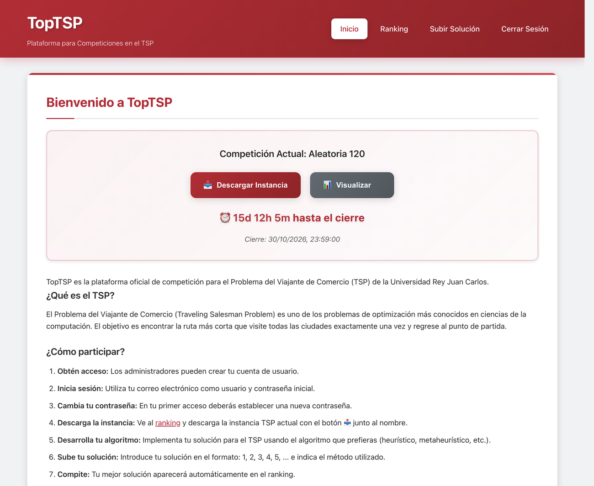

## Tabla de Contenidos

1.  [Características Principales](#características-principales)
2.  [Tecnologías Utilizadas](#tecnologías-utilizadas)
3.  [Instalación y Configuración](#instalación-y-configuración)
    * [Requisitos Previos](#requisitos-previos)
    * [Pasos de Instalación](#pasos-de-instalación)
    * [Acceder a la aplicación](#acceder-a-la-aplicación)
4.  [Credenciales por Defecto](#credenciales-por-defecto)
5.  [Estructura del Proyecto](#estructura-del-proyecto)
6.  [Funcionalidades Detalladas](#funcionalidades-detalladas)
    * [Para Administradores](#para-administradores)
    * [Para Usuarios](#para-usuarios)
    * [Ranking Público](#ranking-público)
    * [Clasificación General](#clasificación-general)
    * [Visualización TSP](#visualización-tsp)
7.  [API Endpoints](#api-endpoints)
8.  [Validaciones Implementadas](#validaciones-implementadas)
9.  [Seguridad](#seguridad)
10. [Estilo Visual URJC](#estilo-visual-urjc)
11. [Base de Datos](#base-de-datos)
12. [Ejemplo de Uso](#ejemplo-de-uso)
13. [Soporte y Mantenimiento](#soporte-y-mantenimiento)
    * [Actualizar un servidor en producción](#actualizar-un-servidor-en-producción)
14. [Capturas de pantalla](#capturas-de-pantalla)
15. [Licencia](#licencia)

## Características Principales

- **Sistema de usuarios** con registro y autenticación
- **Panel de administración** para gestión de usuarios e instancias TSP
- **Subida y validación** de soluciones TSP en tiempo real
- **Ranking dinámico** con ordenación por valor objetivo y fecha
- **Tiempo de resolución** opcional e informativo en cada envío
- **Clasificación General** entre competiciones: medallero y clasificación de óptimos
- **Informe imprimible (PDF)** del ranking con estadísticas, progreso y mejor solución, listo para publicar en Moodle
- **Pausa de la competición** para bloquear temporalmente los envíos
- **Visualización interactiva** de instancias TSP con gráficos D3.js
- **Descarga de instancias** en formato TSPLIB
- **Exportación CSV** de todas las soluciones y del ranking
- **Diseño responsive** con colores institucionales de la URJC

## Tecnologías Utilizadas

- **Frontend**: HTML5, CSS3, JavaScript (Vanilla)
- **Visualización**: D3.js para gráficos interactivos
- **Backend**: Node.js, Express.js
- **Base de Datos**: SQLite
- **Autenticación**: bcrypt + express-session
- **Estilo**: CSS personalizado con colores URJC (rojo, negro, blanco)

## Instalación y Configuración

### Requisitos Previos
- Node.js (versión 14 o superior)
- npm

### Pasos de Instalación

1. **Clonar/descargar el proyecto**
   ```bash
   cd TopTSP
   ```

2. **Instalar dependencias**
   ```bash
   npm install
   ```

3. **Iniciar el servidor**
   ```bash
   npm start
   ```
   
   Para desarrollo con auto-recarga:
   ```bash
   npm run dev
   ```

4. **Acceder a la aplicación**
   - Abrir navegador en: `http://localhost:3000`

## Credenciales por Defecto

- **Usuario administrador**:
  - Email: `admin@urjc.es`
  - Contraseña: `admin`
  - **Importante**: Debes cambiar la contraseña en el primer acceso

## Estructura del Proyecto

```
topabii/
├── server.js              # Servidor principal Express
├── database.js            # Configuración y esquema de SQLite
├── package.json           # Dependencias y scripts
├── topabii.db             # Base de datos SQLite (se crea automáticamente)
├── public/                # Archivos frontend
│   ├── index.html         # Página principal
│   ├── login.html         # Página de login
│   ├── admin.html         # Panel de administración
│   ├── user.html          # Panel de usuario
│   ├── ranking.html       # Página de ranking público
│   ├── visualize.html     # Página de visualización TSP
│   ├── styles.css         # Estilos CSS con tema URJC
│   ├── app.js             # Funciones JavaScript comunes
│   ├── login.js           # Lógica de inicio de sesión
│   ├── admin.js           # Funcionalidad del panel admin
│   ├── user.js            # Funcionalidad del panel usuario
│   ├── ranking.js         # Lógica del ranking público y la Clasificación General
│   ├── ranking-report.html # Informe imprimible del ranking (PDF, solo admin)
│   ├── ranking-report.js  # Generación del informe con gráficos SVG
│   └── visualize.js       # Visualización interactiva con D3.js
└── README.md              # Esta documentación
```

## Funcionalidades Detalladas

### Para Administradores

1. **Crear Usuarios**
   - Introducir emails separados por `;`
   - Los usuarios se crean con su email como contraseña inicial
   - Obligatorio cambio de contraseña en primer acceso
  
2. **Subir Instancia TSP**
   - Subir instancias en formato TSPLIB estándar
   - Validación automática de formato y coordenadas
   - Soporte para EUC_2D (coordenadas euclidianas 2D)
   - Al reemplazar la instancia, las posiciones finales de la competición se **archivan en la Clasificación General** antes de borrar el ranking (solo si hubo participantes; los administradores no cuentan)
   - La configuración de la competición se reinicia: nombre tomado del fichero TSPLIB, sin fecha de cierre, sin pausa y ranking sin congelar
  
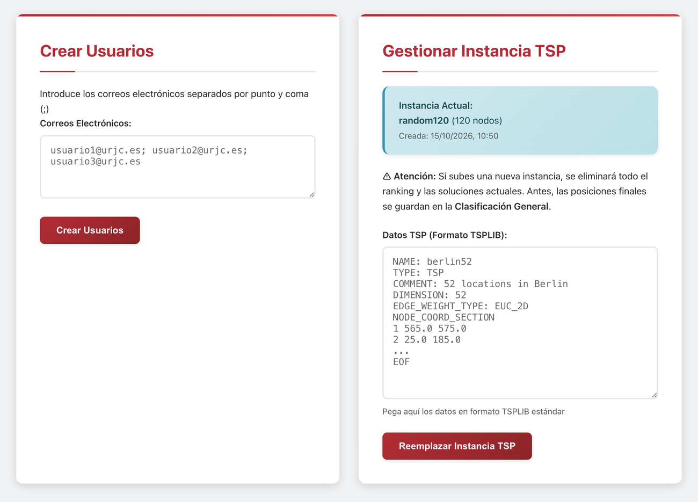


3. **Control del Ranking**
   - Congelar/descongelar visualización del ranking
   - Las soluciones siguen procesándose en segundo plano
   - **Imprimir Ranking (PDF)**: abre un informe A4 con estadísticas (mejor solución, participación, envíos, media, mediana, gaps...), la ruta de la mejor solución, el progreso de la mejor solución, los envíos por día, la clasificación final y el historial de récords. Se guarda como PDF desde el diálogo de impresión
   - **Exportar Ranking CSV**: posición, usuario, email, función objetivo, gap, método, descripción del método, envíos, tiempo y última mejora
   - El informe y el CSV usan siempre los datos actuales (aunque el ranking esté congelado) y excluyen a los administradores

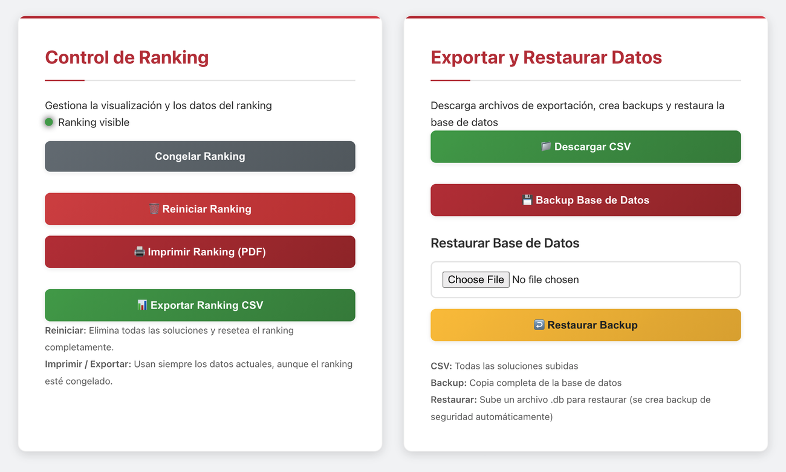

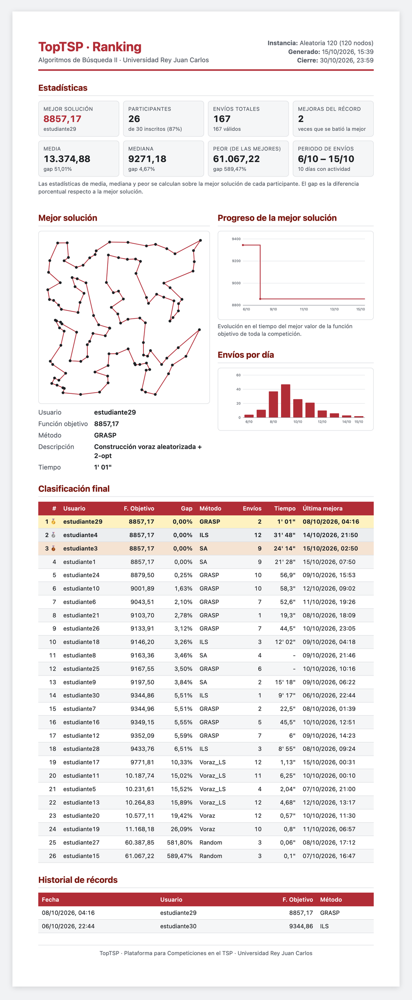


4. **Exportar Datos**
   - Descargar CSV con todas las soluciones
   - Incluye: usuario, solución, valor objetivo, método, descripción del método, tiempo, fecha/hora, validez


5. **Configuración de la Competición**
   - Nombre de la instancia y fecha/hora de cierre
   - **Pausar / Reanudar competición**: mientras está pausada no se pueden enviar soluciones (se avisa en la página del alumno, el ranking y la portada)

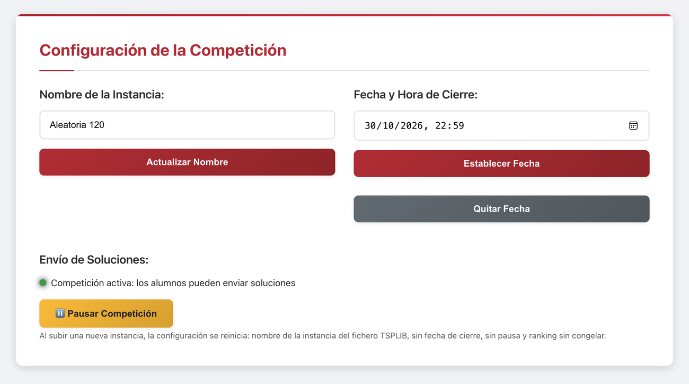

6. **Gestión de Usuarios**
   - La lista se carga automáticamente al abrir el panel
   - **Buscador por correo** que filtra mientras escribes
   - La tabla muestra 5 filas y tiene su propio scroll, con la cabecera fija

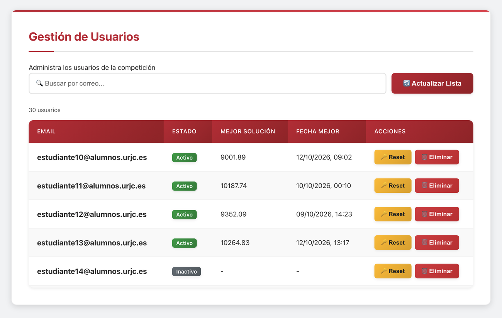

7. **Histórico de Competiciones**
   - Lista de competiciones archivadas que cuentan en la Clasificación General
   - Permite eliminar una competición del histórico si no debe contar

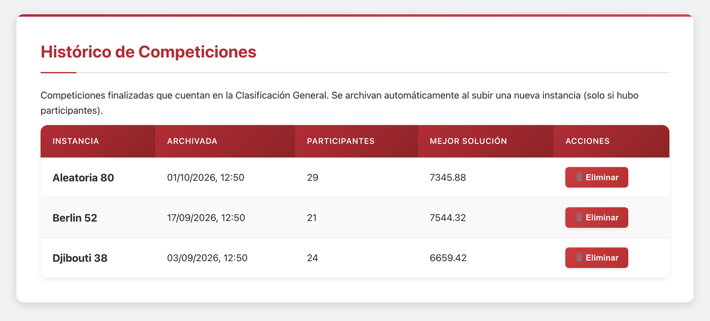

8. **Validador de Soluciones**
       - Herramienta disponible en el panel de administración (sección "Gestión de Usuarios").
       - Permite pegar una solución (nodos separados por comas) y comprobar rápidamente:
          - Si la longitud de la ruta coincide con la dimensión de la instancia cargada.
          - Si todos los nodos están dentro del rango esperado (1..DIMENSION).
          - Si existen errores de formato (comas consecutivas, coma inicial/final).
          - Qué nodos faltan y qué nodos están duplicados (listados para depuración).
       - La comprobación se realiza en el cliente: no sube ni guarda la solución, solo muestra diagnósticos para ayudar a depurar antes de enviar.
       - Útil para administradores y participantes que quieran verificar soluciones antes de enviarlas.

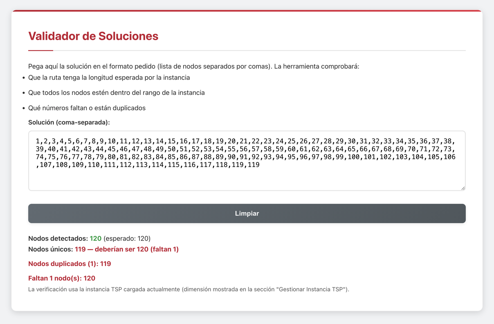


### Para Usuarios

1. **Subir Soluciones**
   - Formato: `1, 2, 3, 4, 5` (números separados por comas)
   - Validación automática de formato
   - Cálculo automático del valor objetivo
   - Solo se guarda la mejor solución de cada usuario
   - **Método (opcional)**: acrónimo de hasta 10 caracteres (p. ej. `GA`), que es lo que se muestra en las tablas, y una **descripción** opcional de hasta 200 caracteres que aparece al pasar el ratón sobre el acrónimo y al visualizar la solución
   - **Tiempo (opcional)**: segundos que ha tardado el algoritmo en obtener la solución. Es solo informativo, no afecta al ranking

2. **Ver Estadísticas Personales**
   - Mejor valor objetivo
   - Número total de envíos
   - Tiempo de la mejor solución
   - Fecha de última mejora
   - Historial de envíos con método y tiempo

3. **Cambiar Contraseña**
   - Actualización segura de credenciales

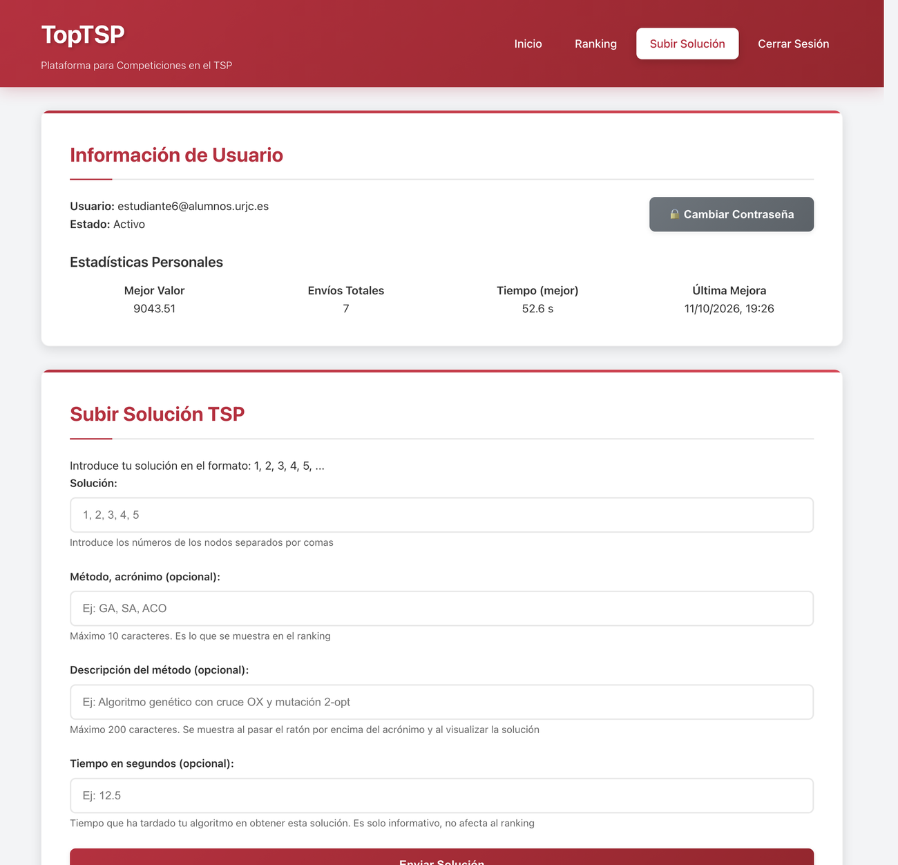

### Ranking Público

- **Acceso libre** (sin necesidad de autenticación)
- **Dos pestañas**: *Competición Actual* y *Clasificación General*
- **Ordenación**: Por valor objetivo (menor mejor), luego por fecha (quien lo consiguió antes)
- **Podio visual**: Destacado especial para top 3 posiciones
- **Tu posición**: si has iniciado sesión, tu fila aparece sombreada en rojo
- **Tiempo**: columna con el tiempo de la mejor solución de cada participante
- **Método**: se muestra el acrónimo; al pasar el ratón por encima aparece su descripción
- **Actualización automática** cada 30 segundos
- **Estadísticas generales**: Participantes, mejor solución, total envíos
- **Últimos envíos**: Tabla con los 5 envíos más recientes de la competición (oculta mientras el ranking está congelado)
- **Botones interactivos**: Descargar instancia y visualizar TSP

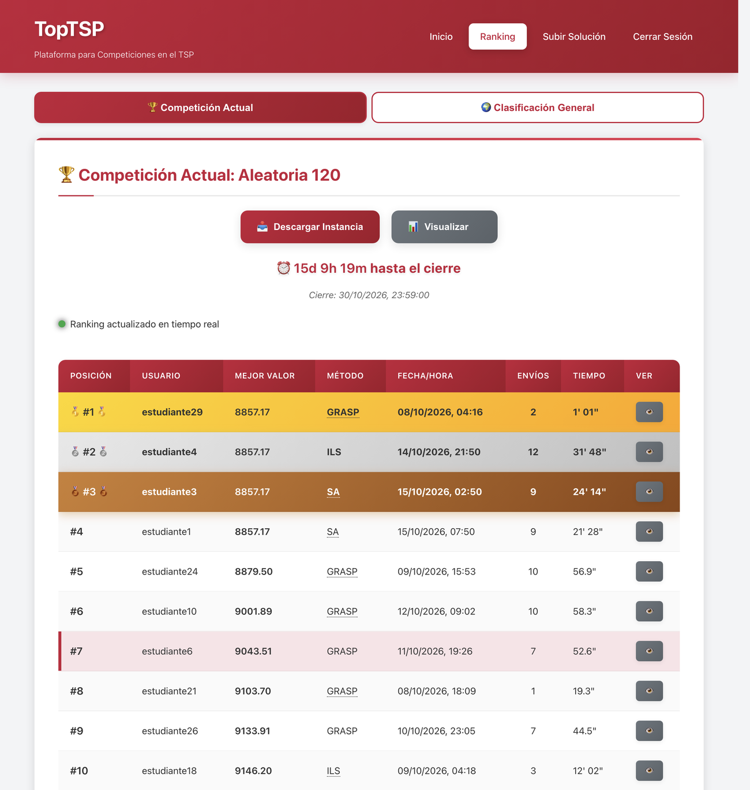


### Clasificación General

Cada vez que el administrador carga una nueva instancia, las posiciones finales de la competición anterior se guardan y pasan a la Clasificación General (`/ranking#general`), que muestra:

- **Medallero**: ordenado por oros, platas y bronces (los puestos son los del ranking: a igual valor, queda delante quien lo consiguió antes). Incluye el número de competiciones, el puesto medio y las **últimas clasificaciones** como `[1][7][3][–]`, con colores oro, plata y bronce
- **Clasificación de Óptimos**: ordenada por la desviación promedio respecto a la mejor solución de cada competición; en caso de empate, por número de óptimos (veces que se iguala la mejor solución de una competición; varios participantes pueden lograrlo en la misma) y, después, por número de competiciones disputadas
- **Competiciones disputadas**: instancia, fecha, participantes, mejor solución y ganador

El puesto medio y la desviación promedio se calculan sobre las competiciones en las que ha participado cada alumno.

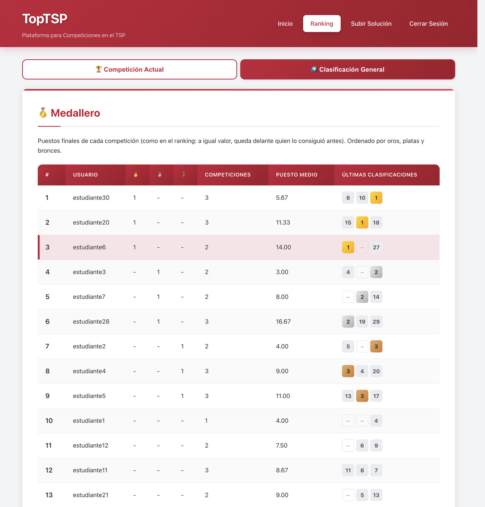

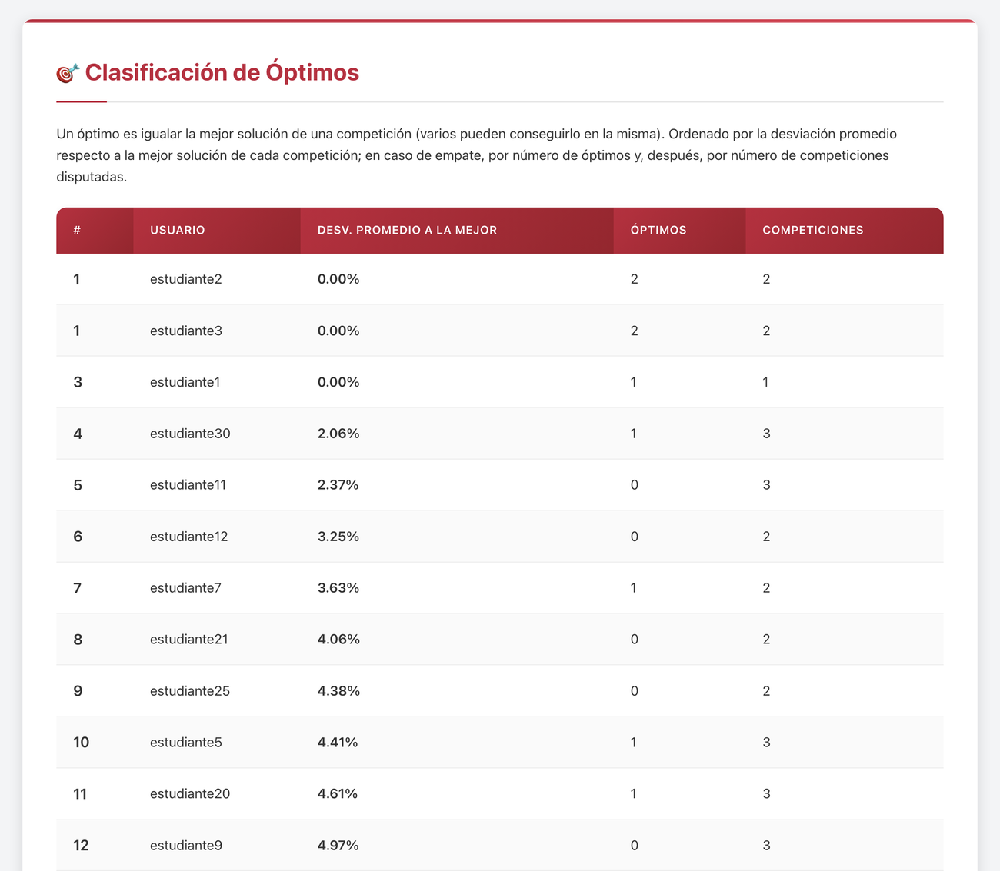

### Visualización TSP

- **Gráfico interactivo** con D3.js
- **Zoom y pan**: Navegación fluida por la instancia
- **Tooltips informativos**: Detalles de cada ciudad al hacer hover
- **Controles de visualización**: Mostrar/ocultar etiquetas, ajustar tamaño de puntos
- **Responsive**: Adaptado a diferentes tamaños de pantalla

Al visualizar la solución de un usuario desde el ranking (`/visualize?userId=...`):

- **Mejor solución del usuario**: Se dibuja su ruta junto con su valor de función objetivo y el método utilizado
- **Historial de envíos**: Tabla con todos sus envíos (número de envío, valor F.O., método, tiempo y fecha/hora), que se puede ordenar por orden de envío o por valor F.O.; la mejor solución se marca con ⭐
- **Ver cualquier envío**: Al pulsar 👁️ en un envío se dibuja su ruta en el mapa (*"Solución del envío #N de ..."*) y el botón **Volver a ver la mejor** recupera la mejor solución
- **Comparar con la mejor del concurso**: La casilla *Mostrar mejor solución del concurso* (desactivada por defecto) superpone en rojo la ruta de la mejor solución de la competición para ver las diferencias con la solución mostrada
- **Progresión de soluciones**: Gráfico con la evolución de los envíos del usuario frente a la mejor solución de la competición

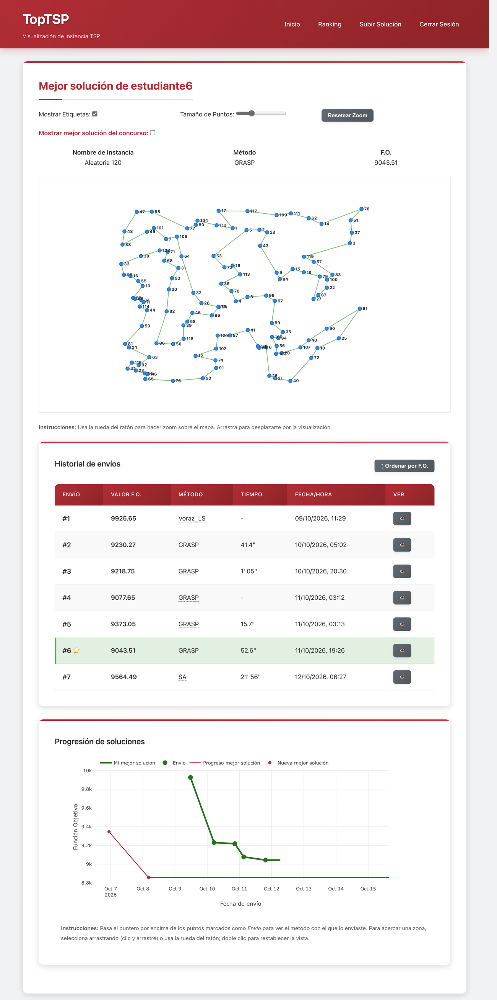


## API Endpoints

### Autenticación
- `POST /api/login` - Iniciar sesión
- `POST /api/logout` - Cerrar sesión
- `POST /api/change-password` - Cambiar contraseña
- `GET /api/user` - Obtener información del usuario actual

### Administración (requiere permisos admin)
- `POST /api/admin/create-users` - Crear nuevos usuarios
- `POST /api/admin/upload-tsp` - Subir instancia TSP
- `POST /api/admin/toggle-ranking` - Congelar/descongelar ranking
- `POST /api/admin/set-paused` - Pausar/reanudar el envío de soluciones
- `GET /api/admin/export-csv` - Exportar datos CSV
- `GET /api/admin/export-ranking-csv` - Exportar el ranking actual en CSV
- `GET /api/admin/ranking-report` - Datos del informe imprimible del ranking
- `GET /api/admin/competition-history` - Competiciones archivadas
- `POST /api/admin/delete-competition` - Eliminar una competición del histórico
- `GET /api/admin/users` - Lista de usuarios
- `GET /api/admin/current-tsp` - Obtener instancia TSP actual (admin)

### Usuario
- `POST /api/submit-solution` - Enviar solución TSP (`solution`; opcionales `method`, `methodDescription` y `time`)
- `GET /api/ranking` - Obtener ranking actual

### Público
- `GET /api/current-instance` - Verificar si existe instancia
- `GET /api/current-instance-coords` - Obtener coordenadas para visualización
- `GET /api/download-instance` - Descargar instancia en formato TSPLIB
- `GET /api/user-solution/:userId` - Mejor solución (ruta) de un usuario
- `GET /api/user-submissions/:userId` - Historial de envíos de un usuario
- `GET /api/user-submission/:userId/:solutionId` - Ruta de un envío concreto de un usuario
- `GET /api/competition-best-solution` - Ruta de la mejor solución de la competición
- `GET /api/competition-best-history` - Historial de mejoras de la mejor solución de la competición
- `GET /api/recent-submissions` - Últimos 5 envíos de la competición (vacío si el ranking está congelado)
- `GET /api/general-ranking` - Clasificación General (competiciones archivadas y resultados agregados por usuario)

## Validaciones Implementadas

### Soluciones TSP
- Todos los nodos presentes (1 hasta N)
- Sin números duplicados
- Formato numérico válido
- Cálculo correcto del valor objetivo
- Tiempo opcional: número de segundos mayor o igual que 0
- Rechazo de envíos si la competición está pausada o ha finalizado

### Instancias TSPLIB
- Formato TSPLIB estándar válido
- Coordenadas en formato EUC_2D
- Dimensión coherente con número de coordenadas
- Cálculo automático de matriz de distancias
- Validación de campos obligatorios (NAME, DIMENSION, etc.)

## Seguridad

- **Contraseñas hasheadas** con bcrypt
- **Sesiones seguras** con express-session
- **Validación de entrada** en cliente y servidor
- **Control de acceso** por roles (admin/usuario)
- **Sanitización HTML** para prevenir XSS

## Estilo Visual URJC

El diseño sigue la identidad visual de la Universidad Rey Juan Carlos:

- **Colores principales**: 
  - Rojo URJC: `#C41E3A`
  - Negro: `#1A1A1A`
  - Blanco: `#FFFFFF`
  - Grises complementarios

- **Tipografía**: Arial, sans-serif
- **Estilo**: Limpio, académico, profesional
- **Responsive**: Adaptado a dispositivos móviles

## Base de Datos

### Tablas Principales

1. **users** - Información de usuarios
2. **tsp_instances** - Instancias del problema TSP
3. **solutions** - Todas las soluciones enviadas
4. **user_best_solutions** - Mejores soluciones por usuario
5. **system_settings** - Configuración del sistema
6. **competition_history** - Competiciones archivadas
7. **competition_results** - Resultado final de cada participante en cada competición archivada (puesto, valor, desviación, método, tiempo)

Las columnas y tablas nuevas se crean automáticamente al arrancar el servidor sobre una base de datos existente, sin perder datos.

## Ejemplo de Uso

1. **Inicio como Admin**:
   - Acceder con `admin@urjc.es` / `admin`
   - Crear usuarios: `user1@urjc.es; user2@urjc.es`
   - Subir instancia TSP en formato TSPLIB

2. **Como Usuario**:
   - Login con email asignado
   - Cambiar contraseña obligatoria
   - Enviar solución: `1, 2, 3, 4`
   - Ver posición en ranking

3. **Ranking Público**:
   - Visible en `/ranking` sin autenticación
   - Se actualiza automáticamente
   - Botones para descargar y visualizar instancia

4. **Visualización**:
   - Acceder desde botones en páginas principal y ranking
   - Vista interactiva en `/visualize`
   - Controles de zoom, etiquetas y tamaño de puntos


## Soporte y Mantenimiento

- **Logs**: El servidor muestra información en consola
- **Base de datos**: Archivo `topabii.db` en directorio raíz
- **Backup**: Realizar copia de `topabii.db` regularmente
- **Reinicio**: `npm start` o reinicio del proceso Node.js

### Actualizar un servidor en producción

1. `git pull` y reiniciar el proceso Node.js (no hace falta `npm install` si no cambian las dependencias)
2. La base de datos se migra sola al arrancar (columnas y tablas nuevas)
3. Recargar el navegador con Ctrl+F5 para obtener los JavaScript nuevos
4. Para empezar una competición nueva, subir la instancia **después** de actualizar: así la competición anterior queda archivada en la Clasificación General

## Capturas de pantalla

Las capturas de este README se han generado con datos de demostración (usuarios `estudianteN@alumnos.urjc.es` e instancias públicas o aleatorias). No contienen datos reales de estudiantes.

## Licencia
MIT License
Desarrollado para la Universidad Rey Juan Carlos - 2025
